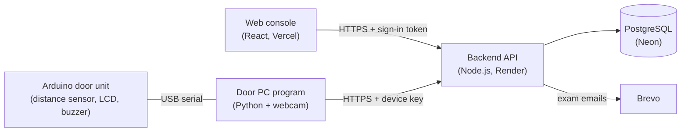

# Smart Registration System

Face-recognition sign-in for exam halls. Invigilators enrol each student's face once; on exam day a camera at the hall door recognises them, shows their seat and records the entry on a live dashboard. Students are signed out automatically when the session ends.

## How the parts fit together

**How to read it:** arrows point from whoever asks to whoever answers. The web console and the door PC both only ever call the backend (the backend cannot reach the PC behind a router, so the PC polls). Only the backend talks to the database. Face embeddings (the numbers that describe a face) stay on the door PC; the backend stores the decision and one enrolment photo.

## What happens
1. **Set up** (administrator): venues with their seat capacity, a door device per venue, accounts for invigilators.
2. **Students and modules:** add students with their modules; **book an exam** for a module in a hall and session (09:00 or 13:00). Every student of the module gets a seat, and is emailed the details (once email sending is set up, see `Backend/README.md`).
3. **Enrol a face:** on the **Enrolment** page, pick the student's door device and press **Start enrolment**. The door PC takes 5 pictures, checks the face is not already enrolled to someone else, and reports *enrolled*.
4. **Exam day:** press **Start recognition** on the door PC. Each student is recognised (with their seat), let in once per session, and appears in *Recognised now* on the dashboard. A printable **sign-in sheet** per exam is the paper fallback.
5. **Session end** (12:00 / 16:00): everyone let in is signed out automatically.

## Repository layout
| Folder | What it is | Start here |
|---|---|---|
| [`Backend/`](Backend) | The API (Node.js, Express, Prisma, PostgreSQL) | [`Backend/README.md`](Backend/README.md) · device API: [`Backend/DEVICE_API.md`](Backend/DEVICE_API.md) |
| [`web_app/`](web_app) | The web console (React, Vite) | [`web_app/README.md`](web_app/README.md) · API calls per page: [`web_app/docs/CONNECTION.md`](web_app/docs/CONNECTION.md) |
| [`pc_device/`](pc_device) | The door program (webcam face recognition) and the Arduino sketch | [`pc_device/README.md`](pc_device/README.md) |
| [`device_client/`](device_client) | Python client for the device API, and a simulator | [`device_client/README.md`](device_client/README.md) |
| [`.github/workflows/`](.github/workflows) | CI (tests on every push) and the keep-awake ping | |
| `package.json` (root) | Local browser-testing tools only (`test-puppeteer.js`); not used by the deployments | |

## Try it
* **Everything on your own computer, with sample data:** [`DEMO.md`](DEMO.md).
* **The door with a real webcam:** [`pc_device/README.md`](pc_device/README.md).

## Deployment
| Part | Where | How it updates |
|---|---|---|
| Backend | Render web service `Smart_Registration_System` (root `Backend/`, `npm start`) | Every push to `main`; database migrations run at start-up |
| Web console | Vercel project `smart-registration-system` (settings in [`vercel.json`](vercel.json)) | Every push to `main` |
| Database | Neon project `Smart_Registration_System` | Schema changes come with the backend (`Backend/prisma/migrations`) |
| Door program | The exam-hall PC | `git pull` there, then restart `srs_pc_app.py` |

Render's free plan sleeps after 15 minutes without requests; `.github/workflows/keep-awake.yml` pings it every 10 minutes on weekdays from 06:00 to 17:00 (South African time).

## Tests
GitHub runs the backend tests (against a fresh PostgreSQL) and the web console's lint and build on every push and pull request: see [`.github/workflows/ci.yml`](.github/workflows/ci.yml). To run them yourself, see [`Backend/README.md`](Backend/README.md#tests).
